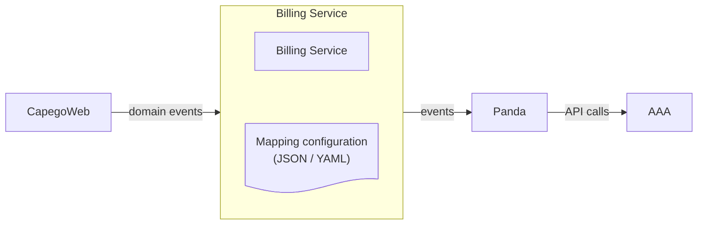

## Mapping configuration attributes

- Event, e.g. `AnnualReportSubmitted`
- Action, e.g. `add 1`
  - `add <value>`
  - `sub <value>`
  - `log`
- Templateid, e.g. `d187a483-1c62-4c66-a259-b43600dad5a7`
- LimitPath, e.g. `AnnualReport/Submitted`

